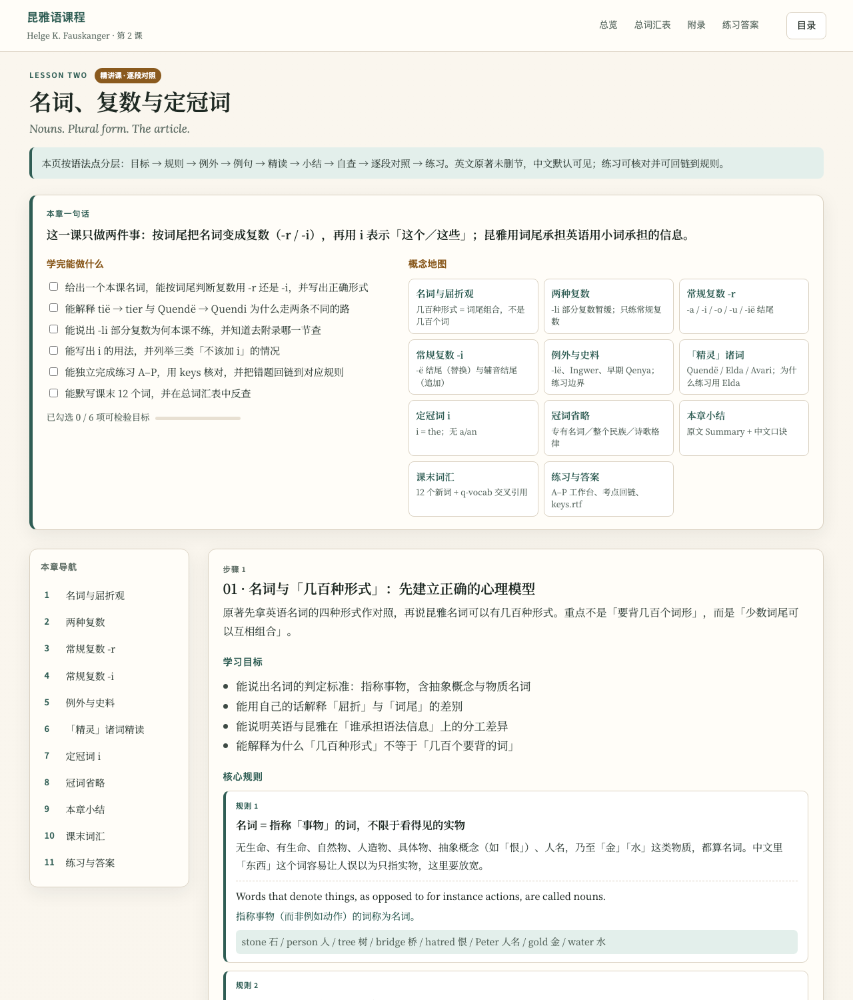
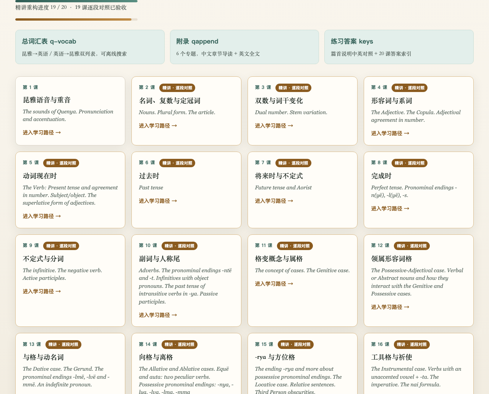

<div align="center">

# 昆雅语教程 · Quenya Course

**Helge Kåre Fauskanger 原著全文 · 中文精讲教学层 · 20 课 · 零后端静态站**


<p align="center">
  
</p>

</div>

---

## 这是什么

一套可以**离线双击打开**的昆雅语（Quenya）教程站，建立在 Helge Kåre Fauskanger 原课程之上：

- **原文一字不删。** 20 课英文原著完整保留在页面里，只在其上叠加中文层，不做删节、不做改写。
- **每课都有可检验的中文精讲。** 不是通篇译文，而是按「目标 → 规则 → 例外 → 例句 → 易错 → 精读 → 小结 → 自查 → 对照 → 练习」组织的教学层，每条规则都挂着原文句子作为依据。
- **逐段 1:1 对照。** 原文每段都配一段中文，左右并排，读原文时不会迷路。
- **纯静态。** 所有内容在构建时烘焙进 HTML，零 `fetch`、零后端、零依赖；`file://` 下双击即开。

## 直接打开

不需要 Python，不需要起本地服务，不需要联网。

```
quenya-web/index.html          ← 双击这个
```

或者把下面的地址粘进浏览器地址栏（注意空格写成 `%20`）：

```
file:///Users/<你的用户名>/Documents/Quenya%20Course/quenya-web/index.html
```

站内链接全部是相对路径，整个文件夹搬到哪儿都能用。

<details>
<summary>想放到 GitHub Pages 上（可选，一次点击）</summary>

仓库已就绪，只差在网页上打开开关：**Settings → Pages → Source 选 `main` / `/ (root)` → Save**。

一两分钟后访问：

```
https://rahakubun.github.io/Quenya-Learning/quenya-web/
```

页面本身是纯静态文件，Pages 直接原样返回，不涉及任何后端进程。
</details>

## 课程目录

| 课 | 中文标题 | 英文原标题 |
|:--:|---|---|
| 01 | 昆雅语音与重音 | The sounds of Quenya. Pronunciation and accentuation. |
| 02 | 名词、复数与定冠词 | Nouns. Plural form. The article. |
| 03 | 双数与词干变化 | Dual number. Stem variation. |
| 04 | 形容词、系词与数一致 | The Adjective. The Copula. Adjectival agreement in number. |
| 05 | 动词：现在时与数一致 | The Verb: Present tense and agreement in number. Subject/object. The superlative form of adjectives. |
| 06 | 动词的过去时 | The Past Tense |
| 07 | 将来时与无定时 | The Future Tense and the Aorist |
| 08 | 完成时与代词 | The Perfect Tense and Pronouns |
| 09 | 不定式、否定动词与主动分词 | The Infinitive, the Negative Verb, and Active Participles |
| 10 | 副词、第三人称复数词尾与被动分词 | Adverbs, the Pronominal Endings -ntë and -t, and Passive Participles |
| 11 | 格系统与属格 | The Case System and the Genitive |
| 12 | 所有格与动名词 | The Possessive Case and Verbal Nouns |
| 13 | 与格、动名词与「我们」 | The Dative Case, the Gerund, and the Pronoun "We" |
| 14 | 向格、离格与所有格词尾 | The Allative and Ablative Cases and Possessive Pronominal Endings |
| 15 | -rya 与位格、关系句 | The ending -rya and more about possessive pronominal endings. The Locative case. Relative sentences. Third Person obscurities. |
| 16 | 工具格与命令式 | The Instrumental case. Verbs with an unaccented vowel + -ta. The imperative. The nai formula. |
| 17 | 指示词、末位变格与 U 词干 | Quenya Demonstratives. Inflecting the "Last Declinable Word". U-stem Nouns. Ordinals. |
| 18 | 独立代词、无人称动词与 lá | Independent Pronouns. Impersonal Verbs. U-stem Verbs. The Various Uses of Lá. |
| 19 | 命令句中的代词、强调代词、疑问词与后置词 | Pronouns in Imperative Phrases. Emphatic Pronouns. Question Words. Postpositions. |
| 20 | to be 的诸形式、疑问助词 ma 与从句助词 sa | The obscure verb "to be". Ma as a possible interrogative particle. Sa introducing nominal clauses. |

> 第 1 课是最初的教学层样板（章节级对照）；第 2–20 课按同一范式逐段重做，均为逐段 1:1 对照 + 练习工作台。

<details>
<summary>展开看目录页</summary>

<p align="center">
  
</p>

</details>

## 每课页面里有什么

| 区块 | 作用 |
|---|---|
| 本章一句话 | 用一句中文说清这课到底在解决什么问题 |
| 学完能做什么 | 可勾选的能力清单，读完能自查是否真的会了 |
| 概念地图 | 全课模块的导航格，点哪跳哪 |
| 学习路径（左侧） | 按步骤编号的目录，长页面不迷路 |
| 规则卡 | 编号 + 中文规则 + **原文逐字引证** + 例句 |
| 例外与易错 | 常见错法 / 正确写法 / 为什么错 |
| 精读理解 | 对原文难句的拆解 |
| 本节小结 | 公式化的要点清单 |
| 自查清单 | 问答对，答案折叠 |
| 中英对照 | 原文段落与中文译本逐段并排 |
| 练习工作台 | 题目、分步提示、规则回链、答案折叠（答案取自 `keys.rtf`） |
| 课末词汇 | 本课新词，与 `q-vocab.rtf` 交叉引用 |

另有三个总表：`vocabulary.html`（词汇总表，可离线搜索）、`appendix.html`（附录六个专题）、`keys.html`（20 课练习答案，篇首附中英对照说明）。

## 仓库结构

```
.
├── less-a.rtf … less-d.rtf      # 原著课程正文（第 1–20 课，字节原样）
├── keys.rtf                     # 练习答案
├── q-vocab.rtf                  # 词汇总表
├── qappend.rtf                  # 附录
├── docs/images/                 # 本 README 的配图
└── quenya-web/                  # 静态站点
    ├── index.html               # 课程目录（入口）
    ├── lessons/lesson-01…20.html
    ├── vocabulary.html
    ├── appendix.html
    ├── keys.html
    ├── assets/css|js/           # 样式与页面脚本
    ├── data/lessons/            # 每课的分段、教学层、词汇、练习、导图（JSON）
    ├── scripts/build_content.py # RTF → JSON → 烘焙 HTML
    └── docs/                    # 计划、交接文档（含逐课验收数据）
```

## 怎么改

原文 RTF 是唯一真相源。**不要手改 `lessons/*.html`**——它们是构建产物，下次构建会被覆盖。

```bash
cd quenya-web
python3 scripts/build_content.py     # 重新解析 RTF、合并教学层、重写全部 HTML
```

上架课次由 `scripts/build_content.py` 里的 `RELEASED_LESSON_MAX` 控制（当前 `20`）。

## 教学层数据格式

每课在 `quenya-web/data/lessons/` 下拆成几份 JSON，构建时按 `sectionId` 合并进页面：

| 文件 | 内容 | 约束 |
|---|---|---|
| `lesson-NN-units-en.json` | 原文逐段英文 | 由 RTF 切分，**不得改字** |
| `lesson-NN-units-zh.json` | 对应中文译本 | 段数必须与 en 完全相等，每段恰好分配一次 |
| `lesson-NN-teaching.json` | 规则卡、例句、易错、精读、小结、自查、逐段对照 | `schemaVersion: 2` 标记「人工精讲」；`rules[].en` 必须逐字命中原文 |
| `lesson-NN-glossary.json` | 课末词汇 | `word` 必须出现在页面文本中 |
| `lesson-NN-exercises.json` | 练习、答案、规则回链 | 答案取自 `keys.rtf`，`ruleRef` 指向真实 rule id |
| `lesson-NN-pedagogy.json` | 章节摘要与导图 | `mindmap.branches[].sectionId` 必须存在 |

## 验收口径

每课交付前跑两轮检查，全绿才算完成：

- **覆盖率**：`units-en` 里每一段都必须出现在页面上，当前 20 课全部 `1.0000`。
- **逐段对齐**：`units-zh` 段数 == `units-en` 段数，且每个 unit 恰好被分配一次。
- **引文逐字**：教学层里所有英文引证必须能在原文中找到原样子串（区分大小写，省略号不算命中）。
- **答案逐字**：练习答案必须与 `keys.rtf` 完全一致。
- **链接与依赖**：0 条失效相对链接，页面内 0 处 `fetch`。

逐课验收数据记录在 [`quenya-web/docs/AGENT_HANDOFF_PROMPT.md`](quenya-web/docs/AGENT_HANDOFF_PROMPT.md)。

## 版权

`less-a.rtf`、`less-b.rtf`、`less-c.rtf`、`less-d.rtf`、`keys.rtf`、`q-vocab.rtf`、`qappend.rtf` 为
**Helge Kåre Fauskanger** 的原著课程材料，版权归原作者所有，此处仅作学习与研究用途收录。

`quenya-web/` 下的中文教学层、页面模板、构建脚本与验收流程为本仓库新增部分。
